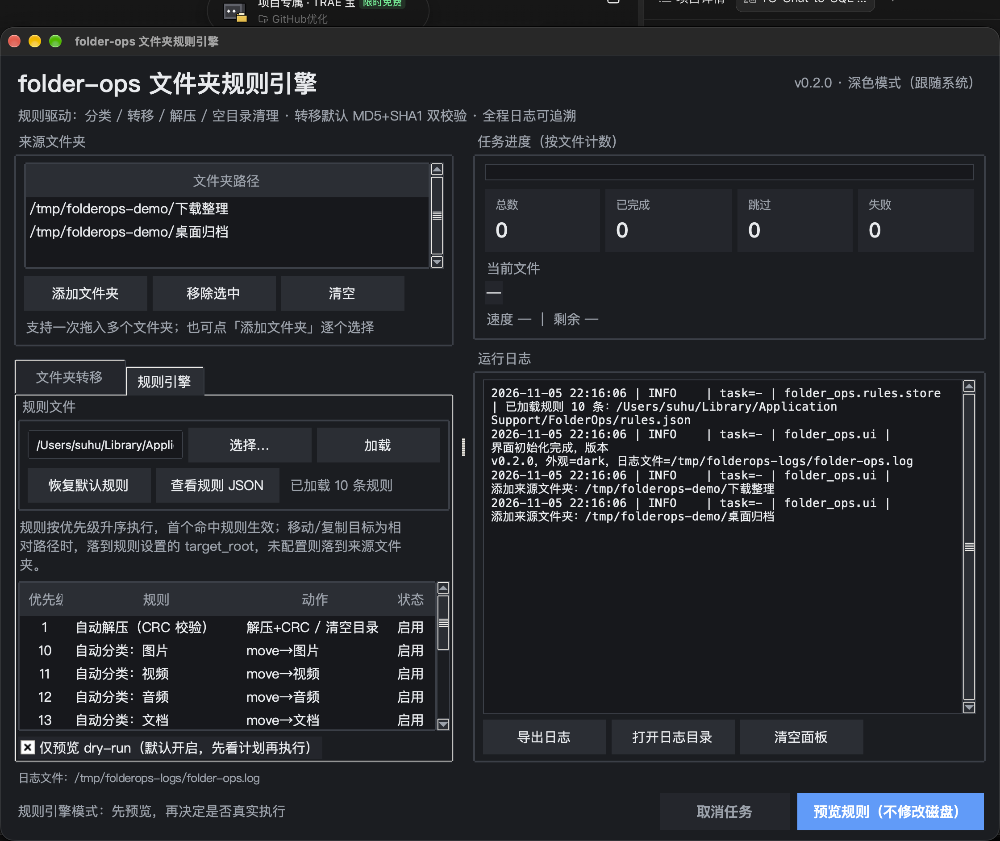
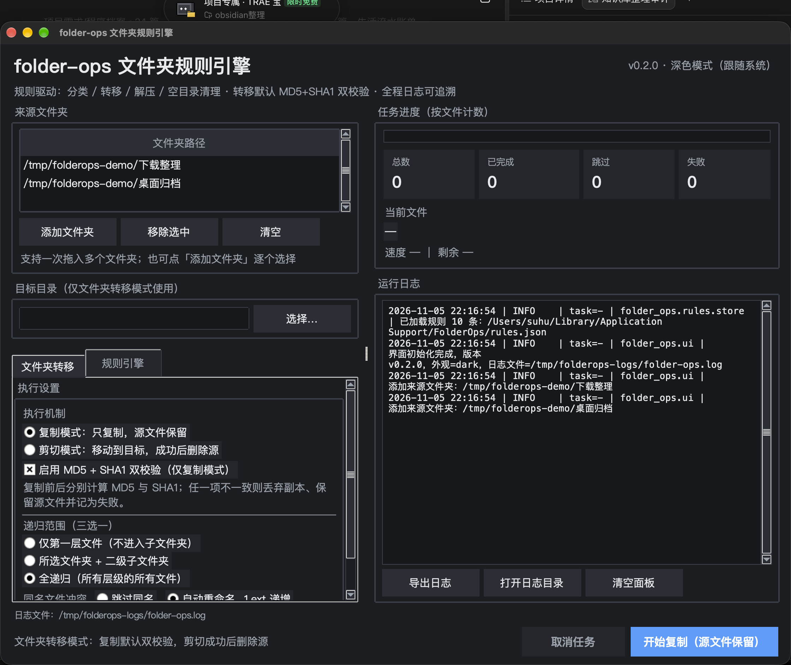

# folder-ops · 文件夹规则引擎

**用一套可预览、可审计的规则，把「自动分类、移动复制、解压校验、清理空目录」做成一个桌面套件。**



> 截图为本仓库 v0.2.0 真实运行画面：深色 GUI、规则清单、dry-run 默认开启、全程日志。

`folder-ops` 是把 4 个分散的小工具仓库收敛后的旗舰项目：

| 原仓库 | 现在的位置 |
| --- | --- |
| FolderCut（本地底座） | GUI + 扫描 + 双校验移动/复制 + 空目录清理 |
| archive-auto-extractor | `folder_ops/archive/`：CRC 三重校验 + 密码库 + 7-Zip 调度 |
| file-auto-classifier | `builtin_classifier` 规则插件（10 个分类） |
| File-Sorting-Tool / File-move-tool | 被「规则 + 动作」模型覆盖，不再单独维护 GUI |

原仓库全部保留、未删除，已归档为只读，并在各自 README 顶部标注指向本仓库。

## 核心特性

- **规则 = 条件 + 动作**：扩展名 / 大小 / 日期 / 文件名正则 / 文件名通配 / 路径正则 / 压缩包 → 移动 / 复制 / 解压 / 删除空目录。
- **内置两个规则插件**：自动分类（10 类）、自动解压（CRC 三重校验 + 可选密码库 + 可选删源）。
- **默认 dry-run**：先看「计划移动到哪里」，确认后再真实执行。
- **不校验不删除**：复制模式 MD5 + SHA1 双校验；压缩包 CRC/文件数/路径/大小 + `7z t` 全通过才允许删除源。
- **可脚本化**：同一套引擎提供 GUI 与 CLI，JSON 报告可用于自动化与回归。
- **跨平台**：macOS 发布 `.app` 内置 7zz；Windows / Linux 自动发现本机 `7z` / `7zz`。

## 快速开始

### 方式一：下载 .app（macOS 11+）

1. 从 [Releases](https://github.com/SuHu4088/folder-ops/releases) 下载 `FolderOps-0.2.0-macos-arm64.zip`。
2. 解压后把 `FolderOps.app` 拖入「应用程序」。
3. 首次打开：右键 →「打开」（产物为 ad-hoc 签名，未做 Apple 公证）。
4. 「规则引擎」标签页默认加载 10 条规则，先点「预览规则（不修改磁盘）」。

### 方式二：源码运行

```bash
git clone https://github.com/SuHu4088/folder-ops.git
cd folder-ops
python3 -m pip install -r requirements.txt
python3 main.py                 # GUI
```

macOS 上建议 Python 3.10+；Windows 需安装 [7-Zip](https://www.7-zip.org/) 才能启用解压动作。

### 命令行

```bash
# 预览（默认不改磁盘）
python3 main.py --source ~/Downloads --dry-run

# 真实执行并输出 JSON 报告
python3 main.py --source ~/Downloads --apply --json-report report.json

# 输出默认规则，便于二次编辑
python3 main.py --print-default-rules > rules.json
```

真实执行示例（测试目录，4 个文件）：

```text
扫描 4 个文件，命中规则 4 个，未命中 0 个
移动 3 / 复制 0 / 解压 1 / 跳过 0 / 失败 0 / 预览 0
清理空目录 1 个
已执行全部动作
```

## 本地打包 / 自行构建

先把当前 Release 的事实说清楚，再决定是否需要自己打包：

| 项目 | 当前 Release（v0.2.0） |
| --- | --- |
| 签名 | ad-hoc（`codesign -dv` 显示 `Signature=adhoc`），无 Developer ID |
| 公证 | 未公证，`spctl -a -vv` 会拒绝 |
| 架构 | 仅 arm64（Apple Silicon），不含 x86_64 |
| Gatekeeper | 首次打开需右键「打开」，或移除隔离属性 |

首次打开被拦截时，任选一种放行方式：

```bash
# 方式 A：Finder 中右键 App →「打开」→ 弹窗里再点「打开」（只需一次）

# 方式 B：移除隔离属性
xattr -dr com.apple.quarantine /Applications/FolderOps.app
```

### Intel Mac 重打包

Release 不含 Intel 产物，Intel Mac 用户需本地执行 `bash script/build_app.sh` 重新打包，前置依赖：

1. Python 3.10+（脚本默认 `/opt/homebrew/bin/python3.14`，可用 `PYTHON_BIN` 覆盖），且自带 Tk 8.6：
   `python3 -c "import tkinter; print(tkinter.TkVersion)"` 应输出 `8.6`。
2. 可联网安装构建依赖：`pyinstaller`、`tkinterdnd2`（脚本自动建 `.venv-build` 并安装）。
3. Xcode Command Line Tools，提供 `codesign`。
4. 7-Zip 可执行文件：仓库已内置 arm64 版 `vendor/macos-arm64/7zz`；Intel 上需替换为 x86_64/通用版
   （`brew install sevenzip` 后复制到该路径），或保留缺失并依赖系统 `7z`/`7zz`（解压动作回退到 PATH 查找）。

```bash
git clone https://github.com/SuHu4088/folder-ops.git
cd folder-ops
bash script/build_app.sh                 # 默认 Python；Intel 可指定 PYTHON_BIN
PYTHON_BIN=/usr/bin/python3 bash script/build_app.sh
# 产物：dist/FolderOps.app（ad-hoc 签名、未公证，仅本机架构）
```

Windows / Linux 无 `.app`，直接用源码或 CLI 运行；Windows 需安装 [7-Zip](https://www.7-zip.org/)。签名、公证与 spec 细节见 [docs/PACKAGING.md](docs/PACKAGING.md)。

## 规则模型

```json
{
  "version": 1,
  "settings": {
    "target_root": "",
    "archive_output_root": "",
    "cleanup_empty": true,
    "password_module_enabled": true,
    "recursion": "full"
  },
  "rules": [
    {
      "id": "builtin.archive.extract",
      "name": "自动解压（CRC 校验）",
      "enabled": true,
      "priority": 1,
      "match_mode": "any",
      "conditions": [{ "type": "extension", "values": ["zip", "rar", "7z"] }],
      "actions": [
        { "type": "extract", "delete_original": false, "password_module": true },
        { "type": "cleanup_empty" }
      ]
    },
    {
      "id": "builtin.classify.图片",
      "name": "自动分类：图片",
      "priority": 10,
      "conditions": [{ "type": "extension", "values": ["jpg", "png", "heic"] }],
      "actions": [{ "type": "move", "target": "图片", "conflict": "rename" }]
    }
  ]
}
```

- 规则按 `priority` 升序执行，**首个命中的规则生效**；移动成功后不再继续该文件的其他文件级动作。
- `target` 为相对路径时：优先落到 `settings.target_root`，未配置则落到来源文件夹。
- 完整字段与校验规则见 [APISpec.md](APISpec.md)，可直接参考 [rules.example.json](rules.example.json)。

## 两种界面模式

| 模式 | 用途 | 安全机制 |
| --- | --- | --- |
| 文件夹转移 | 批量复制/剪切到目标目录 | 复制默认 MD5+SHA1 双校验；剪切校验通过才删源 |
| 规则引擎 | 按规则分类、解压、清理 | 默认 dry-run；动作逐条写日志；解压需 CRC 全通过 |



## 测试与构建

```bash
python3 -m pytest -q
# 72 passed

bash script/build_app.sh
# dist/FolderOps.app（约 35 MB，内置 vendor/macos-arm64/7zz）
```

- 原有 FolderCut 37 个测试全部保留并通过。
- 新增规则引擎 / 压缩包子系统 35 个测试，覆盖条件、优先级、dry-run、冲突重命名、空目录保护、真实解压与篡改检测。
- 详细用例与结果见 [TestPlan.md](TestPlan.md)。

## 项目结构

```text
folder-ops/
├── main.py                  # GUI / CLI 入口
├── folder_ops/
│   ├── ui.py                # Tkinter 界面（两种模式）
│   ├── worker.py            # 转移/复制任务线程
│   ├── rule_worker.py       # 规则任务线程
│   ├── rules/               # 规则引擎
│   │   ├── models.py        # Rule / Condition / Action
│   │   ├── conditions.py    # 7 类触发条件
│   │   ├── actions.py       # 4 类动作执行
│   │   ├── engine.py        # 匹配 + 执行 + 汇总
│   │   ├── plugins.py       # 两个内置插件
│   │   └── store.py         # rules.json 读写与校验
│   ├── archive/             # 压缩包子系统（移植自 archive-auto-extractor）
│   │   ├── seven_zip.py     # 跨平台 7z 发现与调用
│   │   ├── archive_info.py  # 7z l -slt 清单解析
│   │   ├── verifier.py      # CRC 三重校验
│   │   ├── extractor.py     # 7z x
│   │   ├── vault.py         # 密码库（Git 审计）
│   │   └── service.py       # 单包端到端流程
│   ├── scanner.py / mover.py / cleanup.py
│   └── theme.py / macos.py / config.py
├── tests/                   # 72 个测试
├── packaging/FolderOps.spec # PyInstaller 配置
├── script/build_app.sh      # 一键构建 .app
├── vendor/macos-arm64/7zz   # 随包分发（LGPL，见 NOTICE）
└── docs/                    # 运维、打包、数据标注规范
```

## 安全边界

- 复制/剪切：源文件删除前必须通过 MD5 + SHA1 双校验；任一不一致保留源并标记失败。
- 解压：必须同时通过「清单 CRC 对比、文件数/路径/大小一致、`7z t` 自检」；失败不删除原压缩包。
- 规则动作失败不静默：逐条写入 `~/Library/Application Support/FolderOps/logs/folder-ops.log`（Windows 为 `%APPDATA%\FolderOps\logs`）。
- 空目录清理保护来源顶层目录与目标目录，只删除嵌套空目录。

## 已知限制

- `.app` 为 macOS arm64 ad-hoc 签名，未公证；首次打开需右键「打开」或 `xattr -dr com.apple.quarantine`，Intel Mac 需按[本地打包](#本地打包--自行构建)重打包。
- 加密压缩包自动尝试密码库；密码库为空时返回「未解决」，不会误删原包。
- `.tar.gz` 等双后缀的清单解析按 7-Zip 实际输出为准。
- 规则编辑当前通过 JSON（GUI 支持加载、预览、恢复默认）；图形化逐条编辑留待后续版本。

## 文档

- [ProjectPlan.md](ProjectPlan.md) · [RequirementsSpec.md](RequirementsSpec.md) · [SystemDesign.md](SystemDesign.md)
- [APISpec.md](APISpec.md) · [TestPlan.md](TestPlan.md) · [CHANGELOG.md](CHANGELOG.md)
- [docs/OPERATIONS.md](docs/OPERATIONS.md) · [docs/PACKAGING.md](docs/PACKAGING.md) · [DataAnnotationSpec.md](DataAnnotationSpec.md)
- [CONTRIBUTING.md](CONTRIBUTING.md) · [SECURITY.md](SECURITY.md) · [NOTICE](NOTICE)

## 许可

MIT。内置 7zz 遵循 LGPL v2.1+（含 unRAR 限制），详见 [NOTICE](NOTICE)。
