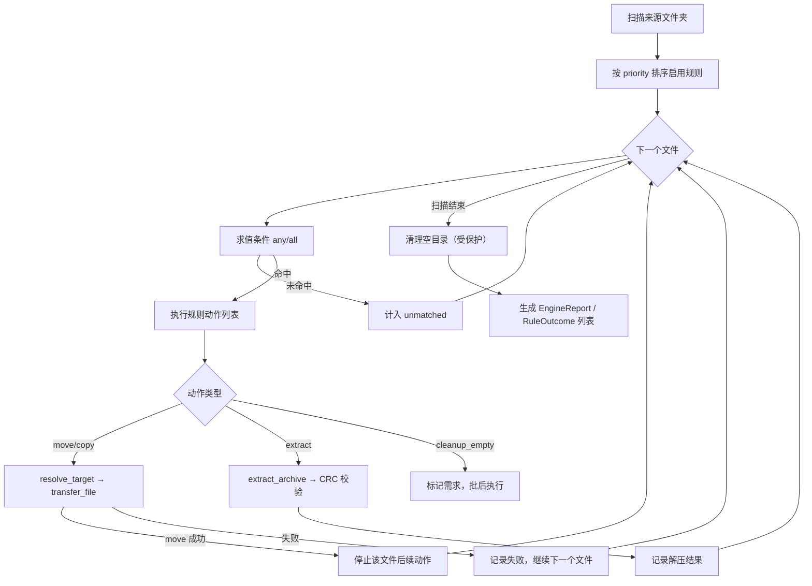

# SystemDesign · folder-ops V0.2.0

## 1. 总体架构

```text
┌────────────────────────────── GUI (Tkinter) ──────────────────────────────┐
│  FolderOpsApp                                                             │
│   ├─ 文件夹转移页 ──> CutWorker（线程）──> scanner / mover / cleanup       │
│   └─ 规则引擎页   ──> RuleWorker（线程）──> RuleEngine                    │
└───────────────────────────────┬────────────────────────────────────────────┘
                                │ 事件队列（scanned/file_start/progress/finished）
┌───────────────────────────────▼────────────────────────────────────────────┐
│ 规则引擎 rules/                                                            │
│  models（Rule/Condition/Action/Settings）                                  │
│  conditions（7 类条件） → engine（匹配/执行/汇总） → actions（4 类动作）   │
│  plugins（builtin_classifier / builtin_archive_extractor）                 │
│  store（rules.json 读写与校验）                                            │
└───────────────────────────────┬────────────────────────────────────────────┘
                                │ 复用
┌───────────────────────────────▼────────────────────────────────────────────┐
│ 底层能力                                                                   │
│  scanner  mover  cleanup    │  archive：seven_zip / archive_info /        │
│ （双校验转移、空目录清理）   │           verifier / extractor / vault /    │
│                             │           service                           │
└───────────────────────────────┬────────────────────────────────────────────┘
                                │
                     文件系统 / 7-Zip / Git（密码库）
```

设计原则：

1. **声明与执行分离**：插件只产出 `Rule` 数据，执行统一在 `actions.py`。
2. **零副作用预览**：dry-run 不写盘、不建库、不清理目录。
3. **失败可定位**：每个动作产出一条 `RuleOutcome` 和一条日志。
4. **算法复用**：CRC 校验、密码库、双校验转移来自已验证实现。

## 2. 模块职责

| 模块 | 职责 | 关键约束 |
| --- | --- | --- |
| `folder_ops/rules/models.py` | 规则数据结构与 JSON 校验 | 未知类型/缺字段抛 `RuleError` |
| `rules/conditions.py` | 条件求值 | 单条件异常降级为 False 并告警 |
| `rules/actions.py` | 移动/复制/解压执行 | 目标=源目录时跳过，避免自重命名 |
| `rules/engine.py` | 扫描、匹配、执行、汇总、清理 | 首命中生效；取消在文件边界 |
| `rules/plugins.py` | 内置分类/解压规则 | 只生成规则，不执行 |
| `rules/store.py` | 默认规则、加载、保存 | JSON 扁平参数结构 |
| `archive/seven_zip.py` | 7z 发现与调用 | 始终 `-p""` + `-y`，防挂起 |
| `archive/archive_info.py` | `7z l -slt` 解析 | 区分头部加密/数据加密 |
| `archive/verifier.py` | CRC 三重校验 | 全部通过才 `ok=True` |
| `archive/extractor.py` | `7z x` | 目标目录必须为空 |
| `archive/vault.py` | 密码库 | 线程锁 + 临时文件 + os.replace |
| `archive/service.py` | 单包状态机 | 探测→解密→解压→校验→删源 |
| `scanner.py` | 递归扫描、计数、清理候选 | 保护顶层目录 |
| `mover.py` | 双校验移动/复制 | 同名策略、跨盘安全 |
| `cleanup.py` | 删除嵌套空目录 | 顶层目录永不删除 |
| `ui.py` | 双标签页 GUI | 事件队列轮询 |
| `worker.py` / `rule_worker.py` | 任务线程 | 通过队列汇报，可取消 |

## 3. 规则执行流程



### 3.1 目标路径解析

```text
target 为绝对路径 → 直接使用
target 为相对路径 → settings.target_root / target（未配置 target_root 时用 task.top）
target 为空        → settings.target_root，仍为空则用 task.top
```

### 3.2 首命中策略

- 规则按 `(priority, id)` 升序；第一条命中的规则消费该文件。
- 同一规则内动作顺序执行；`move` 成功后终止后续文件级动作。
- `cleanup_empty` 不逐文件执行，在批次结束后对 `scan.cleanup_dirs` 执行一次。

## 4. 解压状态机

```text
detect（7z l -slt）
 ├─ 非加密 → extract → verify → [delete_original]
 ├─ 加密且密码模块关闭 → skipped
 └─ 加密且开启 → vault.iter_passwords
      ├─ 7z t 通过 → 重新列清单（头部加密）→ record_success → extract → verify
      ├─ 包损坏 → failed（立即停止）
      └─ 全部失败 → record_failure_all → unsolved
```

校验三项：

1. 清单 CRC 与解压文件 `zlib.crc32` 对比（CRC 为空的条目只比大小）。
2. 文件数、路径集合、大小一致（缺失/多余均失败）。
3. `7z t` 返回 0。

## 5. 并发模型

- GUI 主线程只处理 Tk 事件与队列消费。
- 每个任务一个 `threading.Thread`；取消用 `Event`，在文件边界检查。
- 密码库内部 `threading.Lock`，避免并发写坏 JSON。
- 队列事件：`started / scanned / file_start / progress / finished / error`。

## 6. 持久化

| 数据 | 位置 | 说明 |
| --- | --- | --- |
| 配置 | `~/Library/Application Support/FolderOps/config.json`（macOS） | 上次目标目录、选项 |
| 规则 | 同目录 `rules.json` | 可由 GUI/CLI 指定其他路径 |
| 日志 | 同目录 `logs/folder-ops.log` | 2 MB × 5 轮转 |
| 密码库 | `~/.folder_ops/password_vault` | 独立 Git 仓库，项目外 |

## 7. 错误处理

| 场景 | 行为 |
| --- | --- |
| 文件属性读取失败 | 该文件不匹配，告警日志 |
| 目标目录不可创建 | 动作失败，记录原因，继续批次 |
| 同名冲突且策略 skip | 动作跳过，不覆盖 |
| 7-Zip 不可用 | 解压动作失败，其余动作继续 |
| CRC 校验失败 | 不删除原包，报告失败明细 |
| 密码库不可读 | 按空库处理并告警，不崩溃 |
| 任务异常 | 线程兜底捕获，GUI 显示错误并恢复可操作状态 |

## 8. 打包设计

- PyInstaller `FolderOps.spec`：窗口应用、图标、`tkinterdnd2` 数据、`vendor/macos-arm64/7zz` 二进制。
- `.app` 结构：`Contents/Frameworks/vendor/macos-arm64/7zz`，`discover()` 在 frozen 模式从 `_MEIPASS` 查找。
- 构建后 ad-hoc 签名并 `codesign --verify`；公证留待 V0.5。

## 9. 可测试性设计

- 引擎不依赖 GUI，可直接 `RuleEngine(...).run([...])`。
- `actions.extract_archive` 以模块级符号导入，便于测试 monkeypatch。
- 真实解压测试通过 `vendor/7zz` 运行；无 7z 环境自动 skip。
- 所有文件操作在 `tmp_path` 内，测试不触碰用户目录（密码库测试除外，使用临时目录）。
